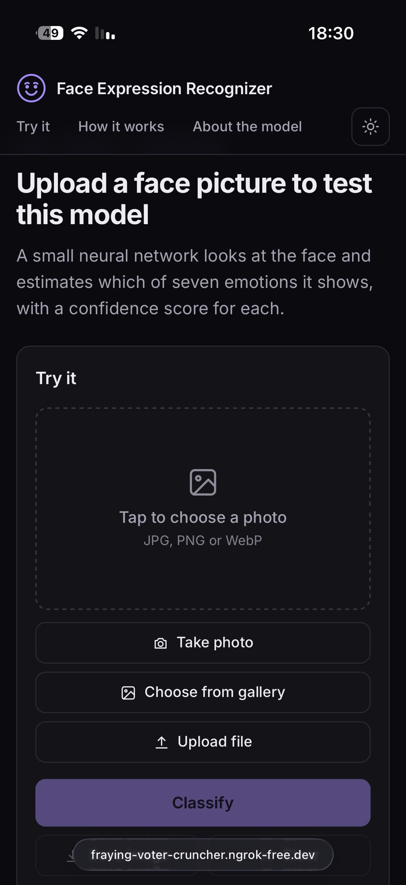
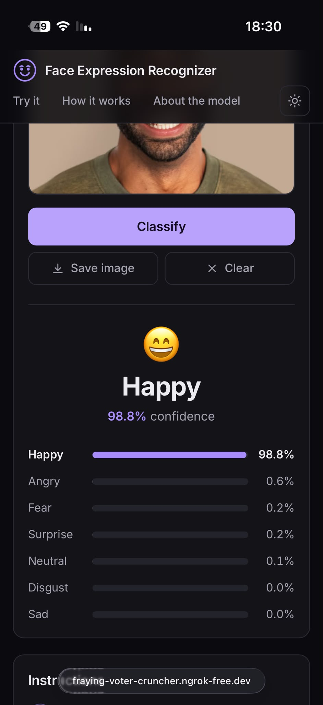
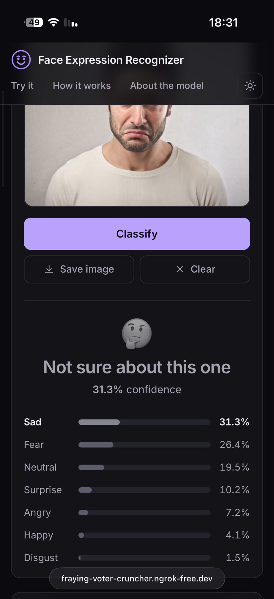

# CNN-Vision-FER-Project
Upload a face image and watch it get classified with one of the 7 emotions the model trained on

## How to run
```
pip install -r requirements.txt
python -m uvicorn app:app
```

## Live Site (Render)
https://cnn-vision-fer-project.onrender.com/
(Server sleeps after being inactive for awhile, might take time to load up)

## The Model
The model was trained on the FER2013 (Facial Expression Recognition) dataset: 28,709 training and 7,178 test images, all 48×48 greyscale faces, each labelled with one of 7 expressions. It was built and trained with TensorFlow/Keras.

### Architecture
Input 48×48 greyscale → three blocks of two 3×3 convolution layers
(32, 64, 128 filters, ReLU, batch normalization), each block followed by
max pooling and dropout (0.25) → Flatten → Dense 128 (ReLU, batch norm,
dropout 0.5) → Dense 7 (softmax). 879,591 parameters.

### Training
Adam optimizer, categorical cross-entropy, data augmentation (shear, zoom,
horizontal flip) and early stopping, then a second round of training with a
lower learning rate, and a final fine-tune using square-root class weights to help rare classes like disgust. 
Trained in Google Colab on 28,709 images and evaluated on 7,178.

## Results
Overall accuracy: about 65% on 7,178 test images.

```
              precision    recall  f1-score   support

       angry       0.56      0.62      0.59       958
     disgust       0.51      0.60      0.55       111
        fear       0.56      0.34      0.42      1024
       happy       0.89      0.84      0.87      1774
     neutral       0.54      0.73      0.62      1233
         sad       0.55      0.49      0.52      1247
    surprise       0.73      0.82      0.77       831

    accuracy                           0.65      7178
```
The test set was also used to pick the best training epoch, so the true accuracy may be slightly lower.

## Limits
- Accuracy varies by emotion: strongest on happy and surprise, weakest on
  fear and sad.
- Clear, front-facing, well-lit faces work best. Blurry, tilted, or
  partly hidden faces give less reliable results.
- If the top confidence is under 60%, the app shows "unknown" instead of guessing.

## Screenshots from Mobile (ngrok)
<p>
  
  
  
</p>
